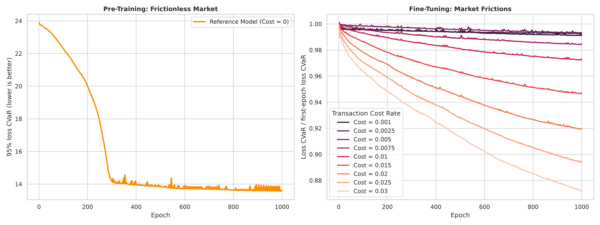
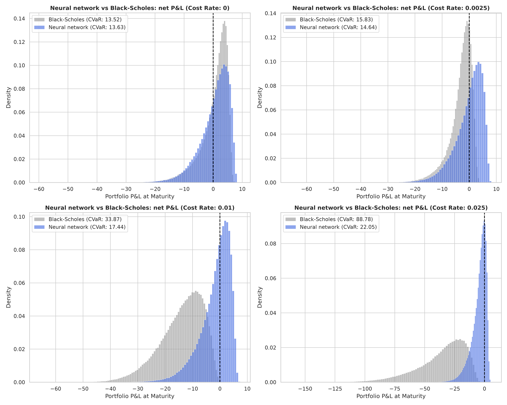
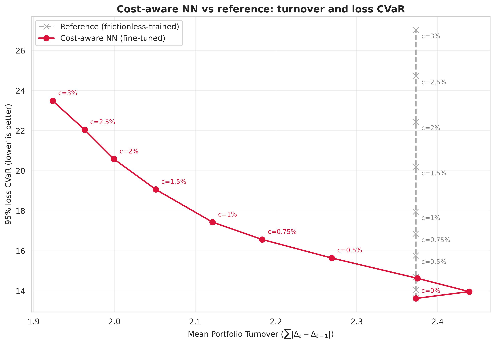
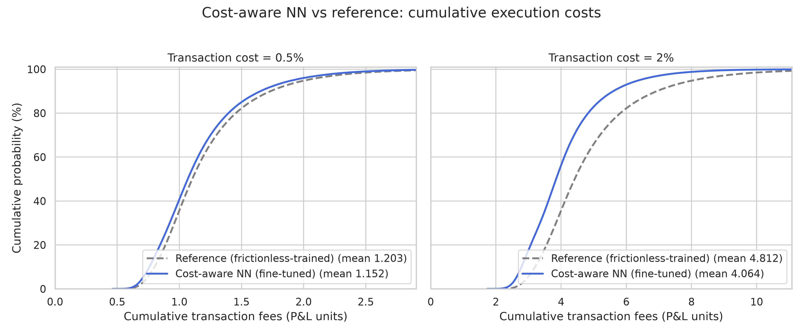
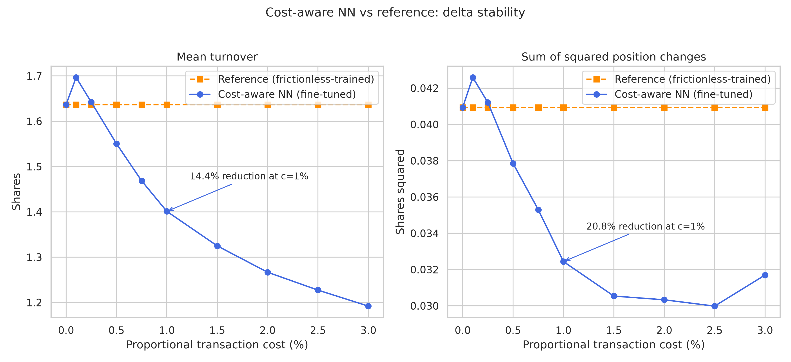
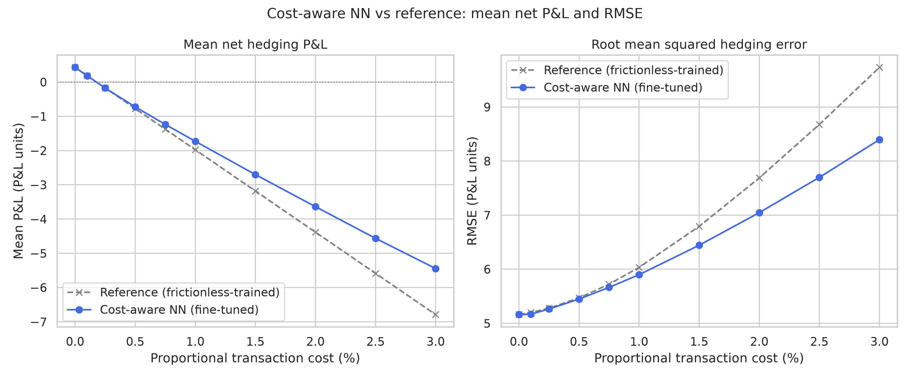

# Deep Hedging under Market Frictions: A Neural Network Approach

## Executive summary

This project studies the delta hedging of a European call under Heston volatility and proportional transaction costs. A neural network is trained in C++ with LibTorch to minimize the 95% loss CVaR of terminal P&L.

The main results are:

* Without transaction costs, the neural network is close to Black-Scholes hedging: loss CVaR is 13.63 versus 13.52 for BS.
* At a 1% cost rate, loss CVaR is 17.44 for the cost-aware NN, 17.96 for the frictionless-trained reference and 33.87 for Black-Scholes. Fine-tuning reduces loss CVaR by about 2.9% compared with the neural reference.
* Comparing with the frictionless-trained reference, fine-tuning at 1% costs reduces turnover by 14.4% and the sum of squared position changes by 20.8%.

Thus, it seems that the neural network tends to reduce both turnover and trade amplitudes to decrease the transaction costs, while providing a good delta-hedging.

## Table of contents
* [Executive summary](#executive-summary)
* [Introduction](#introduction)
* [Methodology](#methodology)
    * [Theoretical Framework](#theoretical-framework)
    * [Architecture and Technical Choices](#architecture-and-technical-choices)
    * [Experimental Setup](#experimental-setup)
* [Results](#results)
* [Limitations and next steps](#limitations-and-next-steps)
* [Appendices](#appendices)
    * [Appendix 1: Theoretical Framework](#appendix-1-theoretical-framework)
    * [Appendix 2: Model Inputs](#appendix-2-model-inputs)

## Introduction
This repository implements a framework for learning and evaluating hedging in incomplete markets. Built natively in C++ using the LibTorch API, the engine addresses a fundamental reality of the trading floor: traditional continuous-time models (like Black-Scholes) break down when exposed to real-world transaction costs and stochastic volatility.

Building on the work of Bühler et al., this project abandons standard complete-market assumptions. We train a neural network to hedge a European call using only the underlying stock and cash. The objective is to minimize the empirical 95% Expected Shortfall of terminal hedging losses under proportional transaction costs. Unlike Bühler, we choose to delta hedge a European call, without vega hedging it.

## Methodology

### Theoretical Framework

This project studies a European call option with maturity $T$. We assume the underlying asset $S$ follows a Heston model.

We construct a self-financing hedging portfolio whose value at time $t$ is denoted by $\Pi_{t}$. This portfolio includes a cash account and a dynamically position of the underlying $S$.

At $t=0$, we initiate the portfolio by selling the European call option. We proxy the initial option premium $P_0$ by using the Black-Scholes formula.

#### Discrete Rebalancing and Transaction Costs

We rebalance the delta hedge at discrete times $t_k$. Let $\delta_k$ denote the number of shares held during the interval $[t_k,t_{k+1})$.

We consider a proportional transaction **cost $c \geq 0$**. At each rebalancing date $t_{k+1}$, the hedge ratio evolves from $\delta_k$ to $\delta_{k+1}$. Thus, the transaction cost incurred at $t_{k+1}$ is therefore: $c S_{t_{k+1}} \vert{}\delta_{k+1} - \delta_{k}\vert{}$

Assuming a **zero risk-free rate**, the self-financing portfolio evolves according to:

$$\Pi_{t_{k+1}} = \Pi_{t_k} + \delta_k ( S_{t_{k+1}} - S_{t_k}) - c S_{t_{k+1}} \vert{}\delta_{k+1} - \delta_{k}\vert{}$$

*NB: a more detailed explanation is in Appendix 1.*

#### P&L and deep hedging
At expiry $T$, we liquidate the remaining stock position and settle the option payoff. The final P&L is thus:
$$PnL=\Pi_T-(S_T-K)^+$$

The network represents an $\mathcal{F}_{t_k}$-adapted strategy $\delta$. We train it to minimize the empirical 95% Expected Shortfall (CVaR) of terminal hedging losses, defined as $-PnL$. This objective focuses on the worst 5% of outcomes. Training does not guarantee that the global minimum is reached.

### Architecture and Technical Choices

This project is designed in C++, for both market simulation and neural network optimization.

- **Monte Carlo simulation**: A Monte Carlo engine generates the Heston paths at the start of each epoch. It uses antithetic paths to reduce variance.

- **C++ neural network**. The framework is built in C++ using **LibTorch** (the PyTorch C++ API). Strict Python is relegated to post-processing and risk visualization.

- **Network and training**. A 3-layer network takes $(\log(S_t), \sqrt{v_t}, T-t, \delta_{t-1})$ as input. The 2 hidden layers contain each 32 neurons and use ReLU activations. It is trained with Adam to minimize 95% CVaR. We apply gradient clipping and halve the learning rate after 50 validations without an improvement.

### Experimental Setup

First the model trains the frictionless strategy ($c=0$), then fine-tunes it for different $c\neq0$.
The two benchmarks are:

* **Black-Scholes standard method:** the delta hedge is recalculated at each trading date. It uses the current simulated Heston variance, with $\sigma_t=\sqrt{v_t}$, rather than a fixed volatility.
* **Frictionless-trained neural reference:** the checkpoint trained at $c=0$ is evaluated with non-zero cost rates, without adapting its weights.

#### Evaluation metrics

* **95% Expected Shortfall (CVaR):** This is the objective loss function optimized during the network's training phase, and also the primary performance metric. By measuring the average loss within the worst 5% of scenarios, this metric captures the tail risk. Lower is better!
* **Turnover:** This metric quantifies the intensity of the portfolio rebalancing. With non-zero friction costs, it is directly penalized.

## Results

### Training and fine-tuning

During pre-training, with zero costs, CVaR falls sharply, then improves more gradually without converging clearly.

Under non-zero transaction costs, fine-tuning reduces the loss, with larger reductions at higher costs. Some curves are still not stabilized at the end of the fine-tuning, suggesting the need for more training.

### Net P&L and comparison with Black-Scholes

Without transaction costs, the neural network has a slightly higher loss CVaR than Black–Scholes delta hedging (13.63 versus 13.52). The small gap may reflect limitations in the neural network's approximation, or a not enough number of epochs. The success of Black-Scholes benchmark can be explained by the use of the real current variance $v_t$ instead of a constant variance.

With costs, it is the contrary: at 1%, loss CVaR is 17.44 for the cost-aware NN, 17.96 for the frictionless-trained reference and 33.87 for Black-Scholes. Fine-tuning therefore reduces loss CVaR by about 2.9% compared with the neural reference. Black-Scholes, whose formula supposes no transaction costs, does not adapt its traded volume to the costs, so the net PnL deteriorates strongly. At higher costs, its P&L distribution moves to the left and becomes more spread out, while the neural network is less affected.

### Incremental benefit over the neural reference

The frictionless-trained network is already much less active than Black-Scholes, since the mean turnover is 2.373 for the network versus 14.408 for Black–Scholes, about 83.5% less. Without costs, the network obtains a tail risk close to BS with a much lower traded volume, even without penalties on trades! This frictionless-trained network is therefore a stronger benchmark for isolating the benefit of fine-tuning. 

We compare the fine-tuned model and the reference (no cost) at the same transaction cost rate: moving left means lower turnover, and moving down means lower CVaR. From 0.5% costs onward, the fine-tuned model combines lower turnover with lower CVaR than this reference. At lower non-zero costs, it remains slightly more active.

### Cumulative execution costs

At 0.5% costs, average cumulative fees decrease from 1.203 to 1.152 P&L units. At 2%, they decrease from 4.812 to 4.064. The distribution shifts towards lower fees, with a more visible separation at higher costs. The blue curve being further to the left means that the same percentage of paths pays lower fees.

### Stability of position adjustments

Mean turnover at 1% costs falls by 14.4%, while the sum of squared position changes falls by 20.8%. These results show a lower traded volume and smaller position adjustments overall.

In other words, training and fine-tuning are not only "trading less": they are reorgazing the hedging to improve the equilibrium costs-risks.

### Mean net P&L and RMSE

Mean net P&L decreases and RMSE increases as transaction costs rise. Fine-tuning limits this deterioration relative to the neural reference. RMSE measures how far the final P&L is from zero. It depends on both the mean P&L and its dispersion.

At 1% transaction costs, fine-tuning reduces mean cumulative fees from approximately 2.406 to 2.157 (−10.4%) and improves mean net P&L from approximately −1.976 to −1.729 relative to the neural reference. Mean gross P&L remains almost unchanged, from approximately 0.430 to 0.428, indicating that the improvement in average net P&L comes almost entirely from fee savings.

## Limitations and next steps

* **Scope of the experiment.** Results concern one European call, one Heston parameter set and one training seed. They do not establish robustness across contracts, market regimes or training runs.
* **Optimization.** A finite neural network is not guaranteed to reach the global CVaR optimum. The frictionless result and the continuing decline in validation loss leave room for optimization improvements.
* **Market assumptions.** Instaneous variance is assumed to be an observable of the market. In practice, it should be estimated from market observations.

We suggest:

1. Testing other Heston parameters, strikes and maturities.
2. Extending the set of hedging instruments to include a second option with non-zero vega. Under idealized continuous-time, frictionless Heston assumptions, this can complete the market. Discrete rebalancing and transaction costs would still introduce hedging errors.

## Appendices
### Appendix 1: Theoretical Framework
#### Paths simulation

Consider a financial market with finite time horizon $T$, with discrete trading dates $0=t_0<t_1<\cdots<t_n=T$. Consider a related probability space $(\Omega, \mathcal{F}, \mathbb{P})$.
We study a European call option with maturity $T$ and strike $K$, with as a underlying an adapted stochastic process $S=(S_k)_{k=0,\cdots,n}$.

In this project, we suppose $S$ follows a Heston model:

$$\begin{cases}
    \frac{dS_t}{S_t} &= r dt + \sqrt{v_t} dW^S_t \\
    dv_t &= \kappa(\theta - v_t)dt + \eta \sqrt{v_t} dW^v_t \\
    d\langle W^S, W^v \rangle_t &= \rho dt
\end{cases}$$

where $W^S$ and $W^v$ are two standard Brownian motions with correlation $\rho \in [-1, 1]$, and:

* $S_0 > 0$: the initial spot price.
* $v_0 > 0$: the initial variance.
* $r \geq 0$: the risk-free rate (equal to 0 in this project).
* $\kappa > 0$: the mean reversion.
* $\theta > 0$: the long-term variance.
* $\eta > 0$: the volatility of the variance.

#### Hedging Portfolio and Initial Valuation

We construct a self-financing hedging portfolio whose value at time $t$ is denoted by $\Pi_{t}$. This portfolio consists of a cash account $B_t$ and a dynamically adjusted position in the underlying asset $S_t$.

At $t=0$, we assume the portfolio is initiated by selling the European call option. We proxy the initial option premium $P_0$ by using the standard Black-Scholes pricing formula evaluated with the initial spot volatility $\sigma = \sqrt{v_0}$:

$$P_0 = P_{\text{BS}}(S_0, K, T, r, \sqrt{v_0})$$

The Black-Scholes pricing function is explicitly given by:

$$P_{\text{BS}}(S, K, T, r, \sigma) = S \Phi(d_1) - K e^{-rT} \Phi(d_2)$$

with $d_1 = \frac{\ln\left(\frac{S}{K}\right) + \left(r + \frac{\sigma^2}{2}\right)T}{\sigma \sqrt{T}}$, and $d_2 = d_1 - \sigma \sqrt{T}$, where $\Phi(\cdot)$ denotes the cumulative distribution function of the standard normal distribution.

#### Discrete Rebalancing and Transaction Costs

In a realistic trading environment, continuous hedging is impossible. We rebalance the hedge at discrete times $t_k$. Let $\delta_k$ denote the number of shares held over the interval $[t_k,t_{k+1})$. We pose $\delta_{-1} = 0$ (no position yet) and $\delta_N = 0$ (liquidation at maturity). The portfolio value $\Pi_{t_k}$ is measured after rebalancing and payment of transaction costs; at $t_N$, it is measured after liquidation and before settlement of the option payoff.

We introduce a proportional transaction cost $c \geq 0$. At each rebalancing date $t_{k+1}$, the hedge is updated from $\delta_k$ to $\delta_{k+1}$. The nominal transaction cost incurred at $t_{k+1}$ for rebalancing the position is therefore:

$$c S_{t_{k+1}} \vert{}\delta_{k+1} - \delta_{k}\vert{}$$

Let $\Delta t = t_{k+1} - t_k$ be the time step length, assuming to be constant for all $k$ for simplicity. Assuming that the cash component of the portfolio accrues interest at the risk-free rate $r$, the value of the self-financing portfolio evolves recursively according to the following discrete-time dynamics:

* At time $t_{k+1}^-$, immediately before rebalancing, the portfolio consists of the cash account $B$ accrued with the risk-free interest rate, and the previous stock position evaluated at the new market price. The value of the portfolio is: $\Pi_{t_{k+1}^-} = B_{t_k}e^{r\Delta t} + \delta_{t_k}S_{t_{k+1}} = (\Pi_{t_k} - \delta_{t_k}S_{t_k})e^{r\Delta t} + \delta_{t_k}S_{t_{k+1}}$
* At time $t_{k+1}^+$, during the rebalancing, we adjust the hedge ratio to the new target $\delta_{t_{k+1}}$. To achieve this, we trade $(\delta_{t_{k+1}} - \delta_{t_k})$ shares at the current market price $S_{t_{k+1}}$. Trading the underlying asset only converts cash into shares (or vice-versa) without changing the gross portfolio value. Therefore, the portfolio value post-rebalancing is simply the pre-rebalancing value minus the transaction fees:

$$\Pi_{t_{k+1}} = \Pi_{t_k}e^{r\Delta t} + \delta_k ( S_{t_{k+1}} - S_{t_k}e^{r\Delta t}) - c S_{t_{k+1}} \vert{}\delta_{k+1} - \delta_{k}\vert{}$$

At $t_0$, the initial hedge $\delta_0$ is established without accruing the option premium, so $\Pi_{t_0}=P_0-cS_0\lvert\delta_0\rvert$.
At $t_N$, no new hedge is opened: the remaining position $\delta_{N-1}$ is liquidated and the option payoff is settled, giving $PnL=\Pi_{t_N^-}-cS_N\lvert\delta_{N-1}\rvert-(S_N-K)^+$.

### Appendix 2: Model Inputs

The Heston model parameters used for the dataset generation are summarized below:

| Parameter | Symbol | Value |
| --- | --- | --- |
| **Initial Spot Price** | $S_0$ | $100.0$ |
| **Risk-Free Rate** | $r$ | $0.0$ |
| **Mean Reversion Speed** | $\kappa$ | $2.0$ |
| **Long-Term Variance** | $\theta$ | $0.04$ |
| **Volatility of Variance** | $\eta$ | $1.1$ |
| **Correlation** | $\rho$ | $-0.1$ |
| **Initial Variance** | $v_0$ | $0.04$ |

The experiment is conducted across a broad spectrum of transaction cost levels: 0%, 0.1%, 0.25%, 0.5%, 0.75%, 1.0%, 1.5%, 2.0%, 2.5% and 3.0%.

The neural network is trained over **1,000 epochs** using a batch size of **50,000 paths** per iteration. The model is initially trained in a frictionless market ($c = 0$) with a learning rate of $10^{-3}$. With frictions ($c > 0$), we use the pre-trained frictionless weights as a starting point with an initial learning rate of $10^{-4}$.

Evaluation is performed on a test set of 500,000 paths.
